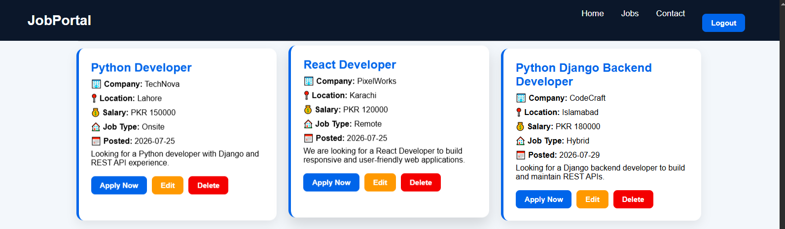

# Full Stack Job Portal

A full-stack job portal where users can register, log in, browse and search jobs, post and manage listings, and apply with a resume upload.

## Tech Stack

- **Frontend:** React.js, HTML5, CSS3, JavaScript, Bootstrap
- **Backend:** Python, Django, Django REST Framework (DRF)
- **Authentication:** JWT
- **Database:** SQLite
- **Tools:** Git & GitHub

## Features

**Authentication**
- User registration and login
- JWT authentication
- Protected routes and logout

**User Profile**
- View profile with authenticated user data

**Job Management**
- Add, edit and delete jobs
- View all jobs and search jobs
- Job details page

**Job Application**
- Apply for jobs with resume upload and cover letter
- Phone number and email fields with form validation

**Application Management**
- View all applications
- Download resumes and see applicant details

**UI**
- Responsive design
- Hero section and statistics section
- Modern job cards and search bar

**Backend**
- REST APIs with CRUD operations
- File upload
- Django models and serializers

## Project Status

In active development. Currently adding advanced authentication, user-specific applications and UI improvements.

## Future Improvements

- Admin dashboard
- Email notifications
- Saved jobs
- Job categories
- Company dashboard
- AI job recommendations

## Author

**Syeda Afshan Sehar**
GitHub: [SyedaAfshanSehar](https://github.com/SyedaAfshanSehar)
